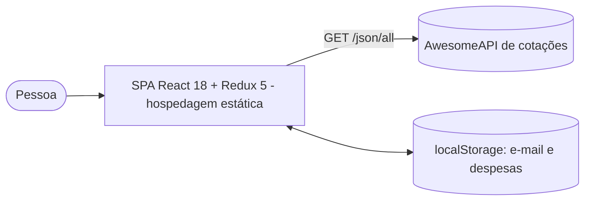
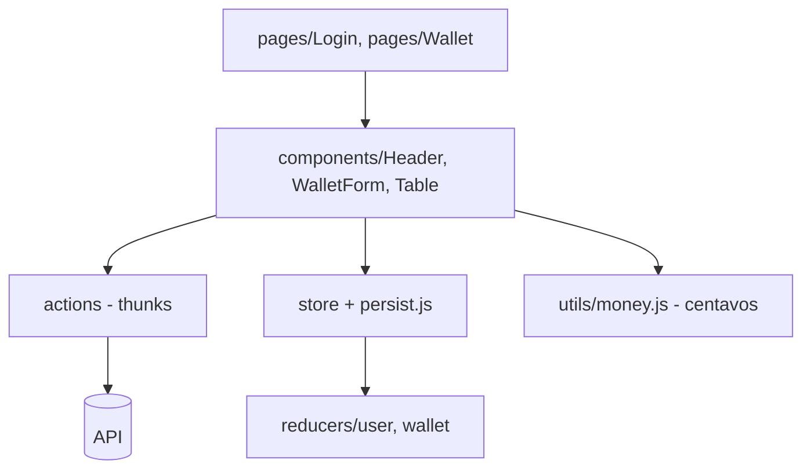

# Arquitetura — Coin Wallet

## Estado

| Chave | Conteúdo | Persistido |
|---|---|---|
| user.email | e-mail do login local | sim |
| wallet.expenses | `{ id, value, description, currency, method, tag, exchangeRates }` | sim |
| wallet.currencies | códigos das moedas (sem USDT) | não (vem da API) |
| wallet.editor / idToEdit | modo de edição | não |
| wallet.error | última falha de rede | não |

## ADRs

| # | Decisão | Motivo | Alternativa |
|---|---|---|---|
| ADR-01 | Manter Redux "puro" (sem Toolkit) | É requisito do projeto e mantém o formato do estado exigido pelo avaliador | Redux Toolkit |
| ADR-02 | Persistência em localStorage | Carteira pessoal, sem servidor | Back-end — fora do escopo |
| ADR-03 | Cálculo em centavos | Evita erros de ponto flutuante no total | `toFixed` sobre a soma |
| ADR-04 | Sem confirmação ao excluir | O requisito 10 pede exclusão imediata | Diálogo de confirmação |
